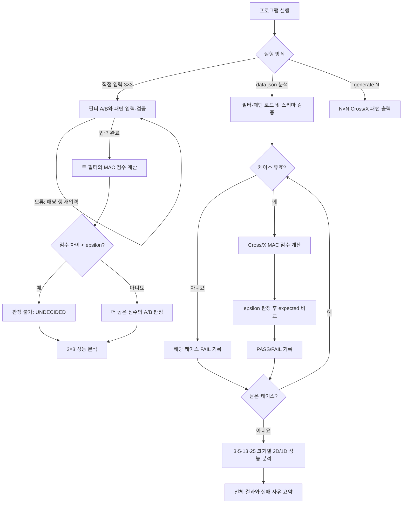

# Mini NPU 시뮬레이터

## 실행 흐름



## 파일 구조

```text
mini-npu-simulator/
├── main.py             # 콘솔 앱: 입력, 검증, MAC, 판정, 성능 측정
├── data.json           # 5×5·13×13·25×25 필터와 평가 패턴
├── README.md           # 실행 방법, 구현 근거, 결과 리포트
├── tests/
│   └── test_main.py    # 입력·동점·JSON 오류·측정 범위 자동 테스트
└── .gitignore          # Python 캐시 파일의 Git 추적 제외
```

Python 3.8 이상, 표준 라이브러리만 사용합니다. `main.py`, `data.json`, `tests/`는 저장소 루트에 있습니다. 목표는 3×3 직접 입력과 JSON 일괄 분석으로 Cross/X를 판정하고, MAC 연산과 크기별 성능을 설명하는 것입니다.

## 실행 방법

```powershell
python main.py
python main.py --mode 2
python -m unittest discover -s tests -v
```

메뉴에서 `1`을 고르면 3×3 필터 A, B와 패턴을 각 3줄씩 입력합니다. `2`를 고르면 동봉된 `data.json`의 모든 패턴을 분석합니다. 자동 실행에는 `python main.py --mode 2`를 사용할 수 있습니다. 다른 JSON은 `python main.py --mode 2 --data 경로\data.json`으로 지정합니다.

보너스 패턴 생성기는 `python main.py --generate 5`처럼 크기 N을 지정해 Cross와 X를 출력합니다(N은 3 이상의 홀수). 직접 입력 모드에서는 필터나 패턴의 첫 줄에 `@Cross` 또는 `@X`를 입력하면 해당 3×3 패턴을 자동 생성해 사용합니다. 성능 분석도 같은 생성 함수를 사용합니다.

3×3 예시: A와 패턴에 `0 1 0` / `1 1 1` / `0 1 0`, B에 `1 0 1` / `0 1 0` / `1 0 1`을 입력하면 A 점수 5, B 점수 1, 판정 A가 나옵니다. 행의 숫자 개수나 숫자 형식이 틀리면 해당 행을 다시 입력받습니다.

## 구현 요약

`mac_2d`는 같은 위치의 패턴 값과 필터 값을 곱해 누적합니다. `mac_1d`는 행 우선 순서로 펼친 배열에서 같은 계산을 합니다. `make_pattern(N, "Cross")`와 `make_pattern(N, "X")`는 홀수 크기의 기본 패턴을 만들며 성능 측정에 사용됩니다.

JSON의 `size_N_idx`에서 N을 읽어 `filters.size_N`을 선택합니다. 필터 키 `cross`/`x`와 기대 라벨 `+`/`x`를 내부 라벨 `Cross`/`X`로 정규화합니다. 행과 열 크기, 숫자 유효성, 필터 존재 여부를 케이스마다 검증합니다. 점수 차이의 절댓값이 `1e-9` 미만이면 `UNDECIDED`로 판정합니다.

| 코드 | 역할과 그렇게 구현한 이유 |
|---|---|
| `make_pattern` | N×N Cross/X를 자동 생성해 입력 예시와 성능 측정에 같은 모양을 재사용합니다. |
| `read_matrix` | 한 행씩 읽고 오류가 난 행만 다시 받아 이미 맞게 입력한 행을 보존합니다. |
| `validate_matrix` | JSON 배열의 크기와 유한한 숫자를 먼저 확인해 MAC의 잘못된 인덱스 접근을 막습니다. |
| `load_filters` / `analyze_case` | 필터를 크기별로 준비하고 케이스 키의 N에 맞는 필터만 선택합니다. 케이스 오류는 다음 케이스를 막지 않습니다. |
| `normalize_label` / `decide` | 데이터 표기를 통일한 뒤 두 모드에 같은 epsilon 판정 정책을 적용합니다. |
| `flatten` / `mac_1d` | 행 우선 1D 배열로 바꿔 2D 인덱싱과 같은 MAC 결과를 다른 접근 방식으로 계산합니다. |
| `benchmark` / `print_performance` | 동일 입력의 함수 호출만 재고 크기별 평균 ms와 정확한 N² 연산 횟수를 표시합니다. |
| `user_mode` / `json_mode` / `main` | 입력 흐름, JSON 일괄 분석, 메뉴와 CLI 옵션을 나눠 각각 검증할 수 있게 합니다. |

성능 표는 각 크기의 동일한 입력과 필터로 2D와 1D MAC 함수를 각각 **10회** 실행한 평균입니다. 코드의 `REPEATS = 10`은 평가기준의 최소 반복 횟수와 일치합니다. `perf_counter_ns`로 함수 호출 구간의 총 시간을 재고 10으로 나눠 ms로 변환합니다. 파일 읽기, 화면 출력, 패턴 생성, 1D 변환은 측정 구간에서 제외합니다. 자동 테스트는 I/O 함수가 측정 중 호출되지 않고 두 MAC 함수가 각각 10회 실행되는지 확인합니다. 1D 변환에도 비용이 있으므로 표의 시간만으로 전체 실행 속도를 단정할 수 없습니다.

### 점수와 판정의 의미

MAC 점수는 같은 위치의 입력값과 필터값을 곱해 더한 **내적**입니다. 3×3 Cross 입력은 Cross 필터에서 1이 겹치는 다섯 위치로 5점, X 필터에서는 가운데 한 위치로 1점을 얻습니다. 같은 크기의 두 필터 중 더 높은 점수를 선택하는 이유는 필터가 강조한 위치에 입력값이 놓일수록 곱의 합이 커지기 때문입니다. 다만 0×0은 0점이라 빈칸의 일치에 보너스를 주지 않으며, 큰 가중치는 모양과 별개로 점수를 높일 수 있습니다. 따라서 MAC 점수를 완전한 형태 유사도나 확률로 해석하지 않고 **해당 크기의 두 필터에 대한 반응 점수**로 해석합니다.

모드 1은 점수가 높으면 A/B로 판정하고, 차이가 `1e-9` 미만이면 화면에 `판정 불가 (UNDECIDED)`를 표시합니다. 기대 라벨이 없으므로 PASS/FAIL은 매기지 않습니다. 모드 2도 동일한 epsilon 규칙으로 Cross/X/UNDECIDED를 판정한 뒤 정규화된 expected와 비교합니다. expected는 Cross 또는 X이므로 `UNDECIDED`는 FAIL입니다. 두 모드 모두 오차 수준의 점수 차이로 임의의 승자를 만들지 않기 위한 정책입니다.

새 라벨을 추가하려면 (1) JSON의 새 필터 키와 expected 표기를 정의하고, (2) `normalize_label` 매핑을 확장하고, (3) 현재 두 점수 전용인 필터 검증·`decide`·출력을 다중 필터 구조로 바꾸고, (4) 기존 두 라벨 및 새 라벨의 정상·동점·스키마 오류 테스트를 추가합니다. 정규화 매핑만 추가해서는 새 라벨이 판정되지 않습니다.

## 결과 리포트

제공된 `data.json` 실행 결과는 총 6건, PASS 3건, FAIL 3건이며 실패 비율은 50.0%입니다.

| 케이스 | Cross 점수 | X 점수 | 판정 | expected | 결과 |
|---|---:|---:|---|---|---|
| size_5_1 | 0.9 | 0.8999999999999999 | UNDECIDED | X | FAIL |
| size_5_2 | 8.9 | 0.1 | Cross | Cross | PASS |
| size_13_1 | 0.3 | 14.700000000000008 | X | X | PASS |
| size_13_2 | 7.499999999999997 | 7.5 | UNDECIDED | Cross | FAIL |
| size_25_1 | 4.9 | 4.899999999999999 | UNDECIDED | X | FAIL |
| size_25_2 | 52.9 | 0.1 | Cross | Cross | PASS |

`size_5_1`, `size_13_2`, `size_25_1`은 두 필터 점수가 수학적으로 동점입니다.
표시된 미세한 차이는 0.1, 0.3 등의 이진 부동소수점 표현과 누적 순서에서 생깁니다.
따라서 엄격한 `>` 비교만 쓰면 우연한 라벨을 선택할 수 있습니다.
허용오차 `1e-9`를 적용하면 세 케이스 모두 `UNDECIDED`가 됩니다.
각 케이스의 expected는 X 또는 Cross이므로 정책에 따라 FAIL입니다.
이 결과를 PASS로 바꾸려고 임의의 우선순위나 라벨 편향을 넣지 않았습니다.
라벨 정규화 덕분에 `+`와 `cross`, `x`와 `X`의 표기 차이는 비교 오류를 만들지 않습니다.
잘못된 케이스 키, 누락된 필터, 행·열 크기 오류, 유효하지 않은 값은 해당 케이스의 데이터/스키마 FAIL로 구분합니다.
점수가 충분히 다른데 expected와 다르면 필터 가중치, 데이터 라벨, MAC 구현을 차례로 확인해야 합니다.
이 데이터에서는 그런 불일치가 관찰되지 않았으며 세 실패는 수치 비교 정책에서 발생합니다.

크기가 N×N이면 MAC 한 번에 정확히 N²개의 위치별 곱셈과 누적이 필요합니다.
3×3, 5×5, 13×13, 25×25의 연산 횟수는 각각 9, 25, 169, 625입니다.
따라서 이 구현의 시간 복잡도는 O(N²)이며 입력 배열도 N²개의 값을 저장합니다.
다음은 Windows의 Python 3.15에서 실행한 한 번의 측정 예시입니다. 각 값은 동일 입력을 **10회** 처리한 함수 호출 평균입니다.

| 크기 | 2D 평균(ms) | 1D 평균(ms) | 곱셈 횟수 |
|---|---:|---:|---:|
| 3×3 | 0.001610 | 0.000890 | 9 |
| 5×5 | 0.002850 | 0.001750 | 25 |
| 13×13 | 0.012700 | 0.010060 | 169 |
| 25×25 | 0.044740 | 0.033430 | 625 |

5에서 25로 N을 5배 늘리면 MAC 곱셈 횟수는 25에서 625로 **25배** 늘어납니다. 실행 시 성능 표에서 현재 환경의 평균 ms를 다시 확인할 수 있습니다. 짧은 10회 측정은 타이머·반복문 비용과 시스템 부하에 영향을 받으므로 실측 시간이 정확히 25배가 되지는 않습니다. 연산 횟수의 증가가 O(N²)의 근거입니다.

### 최적화 우선순위와 CPU/NPU 비교

작은 N에서는 함수 호출, 타이머, 1D 변환 비용의 비중이 커서 배열을 펼치는 작업이 손해일 수 있습니다. 큰 N에서는 N²번의 곱셈·누적과 인덱싱·메모리 접근 비용이 누적됩니다. 이 과제에서 먼저 비교한 대상은 **2D 인덱싱 대 1D 순차 접근**입니다. 1D 변환에는 O(N²) 시간과 추가 O(N²) 공간이 들므로, 입력을 한 번만 계산한다면 변환까지 포함한 전체 처리 시간도 살펴야 합니다. 같은 배열을 여러 번 계산할 때 변환 비용을 나눠 부담할 수 있습니다. 최적화 여부는 여러 실행과 더 많은 반복으로 확인하는 것이 적절합니다.

CPU도 멀티코어와 SIMD를 이용해 병렬 계산을 할 수 있습니다. NPU는 대량의 MAC을 병렬로 처리하도록 연산기와 데이터 이동 구조를 설계한 장치입니다. 입력·가중치를 가까운 메모리에 재사용하면 외부 메모리 왕복을 줄일 수 있지만, 메모리 대역폭이 부족하면 연산기가 많아도 데이터를 기다립니다. 이 Python 코드는 CPU의 순차 루프이므로 실제 NPU 가속률을 측정하지 않습니다. 1D 비교는 메모리 접근 방식을 이해하기 위한 작은 실험입니다.
